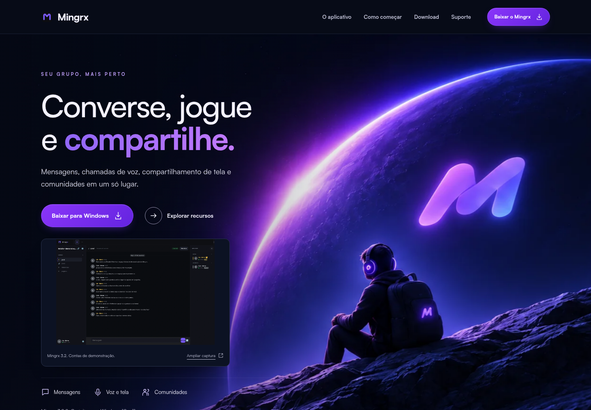
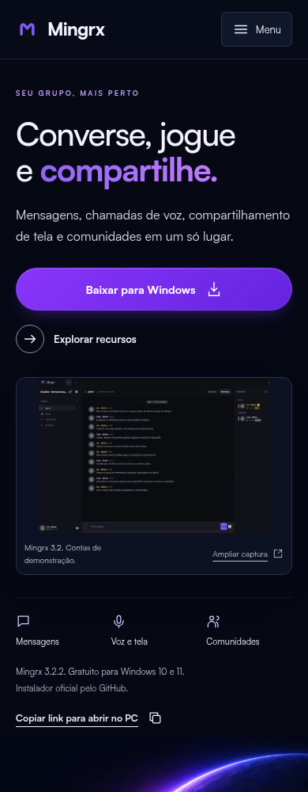
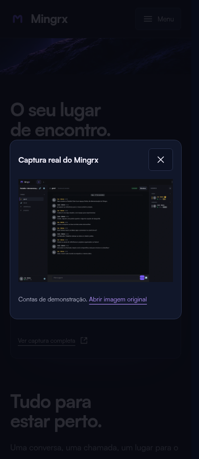
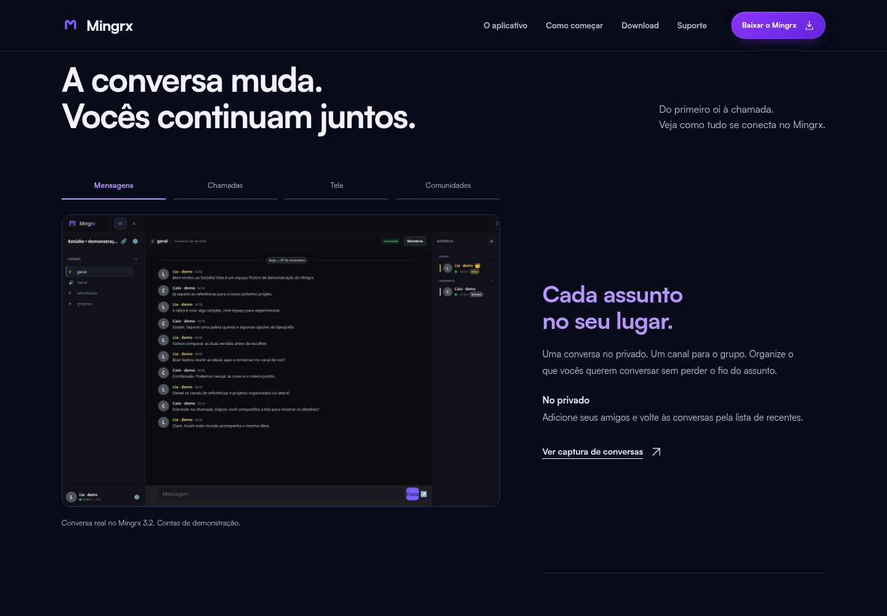

# Prévia do redesign Mingrx

Direção atual: cena espacial aprovada pelo usuário, com personagem sentado, lua com M e violeta/azul. As imagens abaixo são capturas do site implementado no navegador. O hero inclui uma captura verdadeira ampliável e a ilustração decorativa do personagem/lua; são elementos distintos. As capturas seguem identificadas com conteúdo de demonstração.

## Desktop



[Ver página desktop completa](desktop-completo.png)

## Mobile



[Ver página mobile completa](mobile-completo.png)

## Ampliação da captura



## Prévia interativa local

Na raiz do repositório, na branch `redesign/premium-institutional`:

```sh
node site/build.mjs
node site/preview.mjs
```

Abra http://127.0.0.1:4173/ na mesma máquina. O build requer Node.js e curl para obter/verificar a fonte licenciada oficial. Não é necessário instalar as dependências do aplicativo desktop. Ctrl+C encerra o servidor.

O servidor atende apenas o build estático, sem publicar o site, alterar domínio ou iniciar backend/Firebase. As capturas em documentos não entram nos arquivos enviados ao GitHub Pages. A imagem completa de uma captura estática não representa todas as posições de uma seção sticky; as mudanças durante scroll são exercitadas pelos testes de navegador.

## Progresso e comunidades




[Conferência do briefing ampliado](../site-expanded-checklist.md) · [Pesquisa no Refero](../site-reference-research.md)

[Componentes reutilizáveis e exemplos](../site-components.md)


## Responsividade e acessibilidade

[Tablet768px](tablet.png) · [Navegação sem JavaScript](sem-javascript.png) · [Galeria sem JavaScript](galeria-sem-javascript.png) · [Convite sem JavaScript](convite-sem-javascript.png) · [Foco visível na captura](foco-captura.png)

[Auditoria dos itens9–13, correções e limites](../site-responsive-accessibility.md). O fallback sem scripts usa links nativos; o layout com scripts não alterna de altura durante a inicialização.
